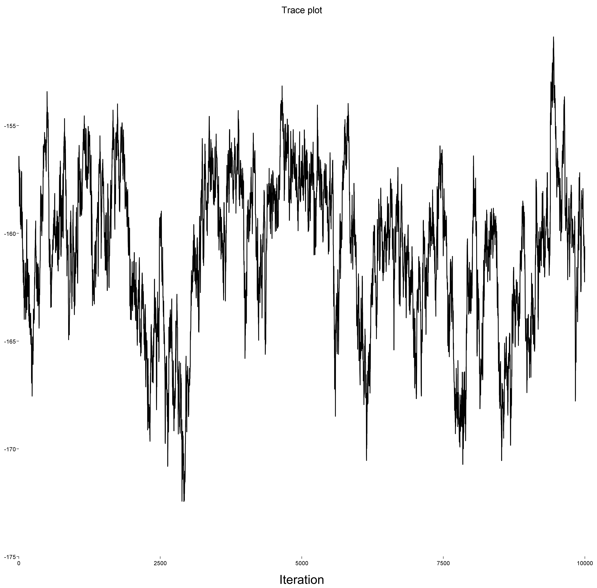
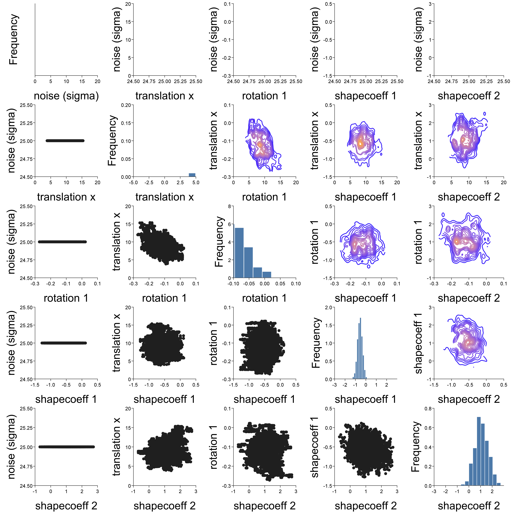

# femur_asm_segmentation

Group project with Hari Narayanan. We segmented femurs in CT images by fitting a statistical
shape model with an active shape model (ASM) intensity term, using Markov chain Monte Carlo
(Metropolis-Hastings) in Scala with [Scalismo](https://scalismo.org).

The report is in `Fitting/PSM_Final.pdf`.

## Setup

- Input: a CT image, landmarks on the femur, and contour points.
- 5 validation images (4, 14, 23, 25, 30) with given landmarks and ground-truth
  segmentations.
- 5 test images (1, 9, 10, 13, 37) without labels. We placed the landmarks for these
  ourselves.
- Sample = pose (rotation, translation) + shape model coefficients.

## Fitting

We first used one chain with the given landmarks, but the results were not plausible femurs.
So we run three chains one after the other, each starting from the best sample of the
previous one (`src/main/scala/fitting/Main.scala`):

| chain | proposals | posterior | samples |
|---|---|---|---|
| 1 | rotation + translation | closest point × prior × landmark likelihood | 7,000 (after 1,000 burn-in) |
| 2 | shape + rotation + translation | same as chain 1 | 10,000 |
| 3 | shape + rotation + translation at several step sizes | prior × landmark likelihood × ASM image intensity | 11,000 |

The step sizes were tuned per image, they are listed in Tables I to III of the report.

## Results

Validation set, fitted mesh vs. ground-truth segmentation (`src/main/scala/validation/Validate.scala`,
distances in mm):

| image | avg. distance | Hausdorff distance |
|---|---|---|
| 4 | 1.17 | 11.93 |
| 14 | 1.30 | 6.35 |
| 23 | 0.46 | 0.46 |
| 25 | 1.18 | 4.00 |
| 30 | 0.81 | 3.82 |

Average distance is around 1 mm for all images. The Hausdorff distance varies a lot: for
image 4 some part of the mesh is almost 12 mm away from the segmentation.

For the test set there is no ground truth, so we only checked the fits visually (figures in
the report).

Trace plot and pairs plot of the last run:




## What we learned

- The three chains improved the fit compared to one chain, but this mostly means the
  proposals of the first chain were not good. One chain with good proposals should be
  enough.
- Adding the ASM evaluator to the posterior of chains 1 and 2 deformed the femur, so we
  only use the intensity term in chain 3.
- Bad landmarks give bad fits. When the landmarks are uncertain, the landmark noise has to
  be larger.

## Open points

- The step sizes were tuned by hand for each image.
- `Main.scala` has the image number hard coded (it is currently set to test image 9), so
  it has to be changed for each run.

## Run

Needs sbt and the course data in `datasets/` (not in this repo): `asm/`, `validationset/`
with `landmarks/`, `segmentations/` and `fitting-results/`, and `testset/`.

```bash
sbt "runMain fitting.Main"
sbt "runMain validation.Validate"
```
